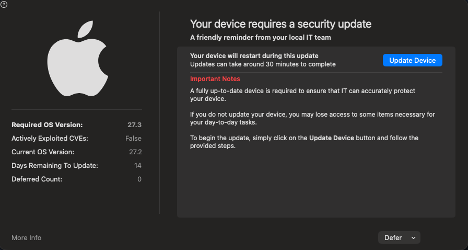
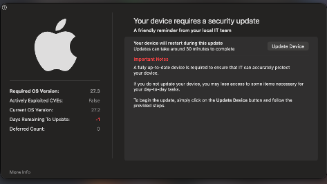

# Lab Journal

Each entry: what I did, what broke, how I fixed it. Newest at the bottom.

---

## 2026-10-23 — Project plan and build guide

- **Did:** Turned a corporate security engineer job description into a portfolio plan, "Corp Security as Code": a threat model plus four connected projects covering endpoint hardening, device-trust access, joiner/mover/leaver automation, and SaaS and AI-agent governance. Wrote a step-by-step build guide using free and open-source tools.
- **Broke:** Nothing.
- **Learned:** Endpoint engineering (MDM, allowlisting) is the core of these roles, so Project 1 gets the most time.

---

## 2026-10-23 — Step 0.1: Repository

- **Did:** Created the public corp-security-as-code repo on GitHub, cloned it to my Mac, created the project folders, and wrote a two-sentence README.
- **Broke:** [Nothing / describe any problem, e.g. a sign-in prompt during git push]
- **Learned:** Git doesn't track empty folders, so each folder needs a placeholder .gitkeep file to show up on GitHub.

---

## 2026-10-23 — Step 0.2: Toolchain

- **Did:** Installed Homebrew, then Git, Python 3.12, pipx, Node.js, OPA and step with one brew command. Installed sigma-cli and ansible-core with pipx, fleetctl with npm, and Docker Desktop.
- **Broke:** When I copied the brew install command from the guide, only stray text ("sl") came through instead of the command.
- **Fixed:** Typed the full command manually: brew install git python@3.12 pipx node opa step.
- **Learned:** Always read a command before pressing Enter, and reopen Terminal after installs so it finds new programs.

---

## 2026-10-23 — Step 0.3: Stable HTTPS hostname

- **Did:** Compared Tailscale Funnel (free) with a Cloudflare domain and Tunnel (about $10/year) and chose Cloudflare. [Bought domain ____, created tunnel corp-lab routed to lab.____, tested from my phone on cellular: padlock OK / not finished yet]
- **Broke:** [Nothing / describe]
- **Learned:** Apple devices only talk to an MDM server over trusted HTTPS, so the server needs a permanent, trusted address. Tunnel credentials in ~/.cloudflared are secrets and never go in the repo.

---

## 2026-10-23 — Step 0.4: Lab journal

- **Did:** Started this journal.
- **Broke:** Nothing.
- **Learned:** Write down exact error messages; they become real interview stories.

---

## 2026-10-23 — Project 0, Step 1: Company profile

- **Did:** Wrote docs/company.md describing Lumen AI: 2,000 employees, 70% macOS fleet, Keycloak SSO, core systems, ~25 internal AI agents and ~300 connected OAuth apps. Chose its product (back-office AI agents) after comparing six real problem areas. [Personalized: changed ___ ] [Drew the environment sketch and saved it to docs/img/]
- **Broke:** Nothing.
- **Decided:** Kept Lumen's customer-facing product out of scope. A customer token vault would have created a top threat that none of my corporate security projects fixes, so scoping it out keeps every threat mapped to a project.
- **Learned:** Each weakness in "Current security state" maps to one project. In the sketch, agents and OAuth apps reach core systems directly, bypassing the SSO gate, which is the reason for Project 4.

---

## 2026-10-23 — Project 0, Step 2: Asset inventory

- **Did:** Listed Lumen AI's assets in four groups (identities, devices, data, control systems), with where each lives and who or what can reach it.
- **Broke:** Nothing.
- **Learned:** Listed Lumen's assets; biggest surprise was that about 300 outside apps can read company email, and nobody picked or reviews them and a stolen session cookie skips both the password and MFA, so a personal laptop can be a way in..

---

## 2026-10-28 — Project 0, Step 3: Attacker stories

- **Did:** Wrote 13 attacker stories in the form "an attacker who has X can do Y because Z," mapped to MITRE ATT&CK and ATLAS (AML.T0051 for prompt injection). Learned to navigate ATT&CK technique pages: description, procedure examples, mitigations, detection.
- **Broke:** My README was saved as README.txt, so GitHub showed it as raw text with the # symbols visible.
- **Fixed:** Renamed it with `git mv README.txt README.md`, because GitHub only formats Markdown files.
- **Learned:** The "because" part of each story is the weakness a control must remove. ATT&CK IDs can be renamed between versions, so I record the version I used.

---

## 2026-10-28 — Project 0, Step 3 (continued): S14, my own story

- **Did:** Researched and found T1490 Inhibit System Recovery on my own, and used it to write S14: backups deleted before ransomware, also tagged T1486 Data Encrypted for Impact. Added backups to the asset list.
- **Broke:** S14's "because" didn't match anything in company.md, since the company file never mentioned backups.
- **Fixed:** Added a backups weakness to company.md, so every story traces back to a stated weakness.
- **Learned:** Ransomware is a chain (delete backups, then encrypt), so tagging both techniques shows the whole attack. Defense: immutable backups, and backup admin rights separate from production admin rights.

---

## 2026-10-28 — Project 0, Step 4: Scoring and ranking

- **Did:** Scored 14 stories by likelihood × impact (1–5 each) using written definitions, ranked them, and checked that every project fixes at least one top-ranked threat (score 12 or more).
- **Revised:** Raised S7 leaver access (likelihood 3 → 4), S12 chat bots (impact 3 → 4) and S10 device management console (likelihood 2 → 3), each with a written reason.
- **Broke:** Nothing.
- **Learned:** Some threats aren't fully covered (S13, S11, S14). Writing down the gap and handing it to the right owner is better than claiming a project solves everything.

---

## 2026-10-28 — Project 0, Step 5: Charters (Project 0 complete)

- **Did:** Wrote one-page charters for Projects 1A, 1B, 2, 3 and 4 in docs/charters/, each linked to ranked threats, with yes/no "done" criteria, metrics, user impact and tooling trade-offs.
- **Broke:** Nothing.
- **Learned:** What's out of scope, and why, matters as much as what's in scope. "Done" has to be testable before the work starts.

---

## 2026-10-28 — Project 1A, Step 1.1: Fleet server (in progress)

- **Did:** Deployed Fleet with its official Docker Compose setup (Fleet, MySQL, Redis), free tier, in ~/fleet-server, outside the repo because .env holds secrets. Set FLEET_SERVER_TLS=false because Tailscale Funnel provides HTTPS. Saved the server private key in my password manager.
- **Broke (1):** `docker compose up` failed: port 6379 already in use.
- **Fixed (1):** `lsof -i :6379` showed a Homebrew Redis holding the port. Stopped it with `brew services stop redis`; all containers then started healthy.
- **Broke (2):** The public address shows DNS_PROBE_FINISHED_NXDOMAIN.
- **Status:** Still troubleshooting. Checking Tailscale connection, exact DNS name, and Funnel status.
- **Learned:** Fleet listens on port 1337, not 8080. Two programs can't use the same port. The .ts.net address only exists publicly while Tailscale is connected and Funnel is on.

---

## 2026-10-28 — Project 1A, Step 1.2: Apple MDM (APNs)

- **Did:** Downloaded a CSR from Fleet, created an APNs certificate at identity.apple.com, and uploaded it to Fleet. Apple MDM is on; certificate expires [date].
- **Broke:** [Nothing / describe]
- **Learned:** APNs only sends a "check in" ping; profiles travel directly between Fleet and the Mac. Renewal must use the same Apple ID, or every Mac must re-enroll.

## 2026-10-30 — Project 1A, Step 1.3: Windows VM

- **Did:** Built a Windows 11 Pro ARM64 VM in UTM with TPM 2.0, renamed it fleet-windows-lab, cloned a clean copy (windows-clean), built an arm64 fleetd MSI with scripts enabled, and installed it.
- **Did:** Built a Windows 11 Pro ARM64 VM in UTM with TPM 2.0, renamed it fleet-windows-lab, cloned a clean copy (windows-clean), and installed the fleetd MSI downloaded from Fleet's Add hosts screen (Workstation).
- **Broke (1):** Unsure whether to pick Workstation or Server in Fleet's Add hosts screen.
- **Fixed (1):** Workstation is for Windows 10/11 laptops and desktops; Server is only for Windows Server. A company laptop is a workstation.
- **Broke (2):** The Windows agent never enrolled (2026-11-02). Resolve-DnsName returned 100.113.48.55, my Mac's private Tailscale address, and Test-NetConnection to port 443 failed.
- **Cause (2):** The VM uses my Mac for DNS, and my Mac's Tailscale DNS answered with the private tailnet address, which the VM can't reach.
- **Fix attempted (2):** Turned off Tailscale DNS on the Mac (`tailscale set --accept-dns=false`) and flushed the DNS cache.
- **Broke (3):** My Mac's browser now shows ERR_CONNECTION_CLOSED for the public address.
- **Status:** In progress. Testing from my phone on cellular to tell "Mac can't loop back to its own Funnel" apart from "Funnel HTTPS not working."
- **Learned:** Windows on Apple Silicon needs ARM64 images and agents (--arch=arm64). Pro edition is required for BitLocker and MDM. The MSI contains the enroll secret, so it stays out of Git. Resolve-DnsName and Test-NetConnection separate "can I find it?" from "can I reach it?".

---

## 2026-11-03 — Project 1A, Step 1.4: Fleet configuration in Git (GitOps)

- **Did:** Backed up Fleet's config outside the repo, exported current settings with `fleetctl generate-gitops`, replaced the enroll secret with a placeholder (`$FLEET_GLOBAL_ENROLL_SECRET`, real value in ~/fleet-server/gitops.env, outside the repo), copied the files into fleet/, added a .gitignore for secrets and installers, and applied with `fleetctl gitops`.
- **Broke (1):** Dry run failed: environment variable FLEET_GLOBAL_ENROLL_SECRET not set.
- **Fixed (1):** Ran `source ~/fleet-server/gitops.env` in the same Terminal window. Each new window needs it.
- **Broke (2):** "fleet/default.yml: no such file or directory."
- **Fixed (2):** I was in ~/fleet-server instead of the repo; ran `cd ~/corp-security-as-code`.
- **Broke (3):** `git add .gitignore` failed: the file had never been created.
- **Fixed (3):** Created .gitignore (env files, installers, keys, backups), then confirmed with `git status` and `git diff --cached` that only YAML, logos and the placeholder secret were committed.
- **Tested:** Renamed the org to "Lumen AI DRIFT TEST" in the UI, then applied GitOps. [The name reverted to "Lumen AI".]
- **Learned:** GitOps resets anything missing from the YAML to defaults, so export and review before applying. Fleet's dry run validates files but doesn't show a field-by-field diff; compare with `fleetctl get config` to see drift. Secrets never live in Git: they're injected from the environment. The folder name in the prompt tells me where I am.

---

## 2026-11-03 — Project 1A, Step 1.4: Fleet configuration in Git (GitOps)

- **Did:** Backed up Fleet's config outside the repo (`fleetctl get config --yaml`), exported the current settings with `fleetctl generate-gitops`, replaced the enroll secret with a placeholder (`$FLEET_GLOBAL_ENROLL_SECRET`, real value in ~/fleet-server/gitops.env, outside the repo), copied the files into fleet/, added a .gitignore for secrets, installers, keys and backups, and applied with `fleetctl gitops`.
- **Broke (1):** "environment variable FLEET_GLOBAL_ENROLL_SECRET not set."
- **Fixed (1):** Ran `source ~/fleet-server/gitops.env`. Each new Terminal window needs it.
- **Broke (2):** "fleet/default.yml: no such file or directory."
- **Fixed (2):** I was in ~/fleet-server instead of the repo; ran `cd ~/corp-security-as-code`.
- **Broke (3):** `git add .gitignore` failed because the file had never been created.
- **Fixed (3):** Created .gitignore, then confirmed with `git status` and `git diff --cached` that only YAML, logos and the placeholder secret were committed.
- **Tested:** Renamed the org to "Lumen AI DRIFT TEST" in the UI, then applied GitOps. [The name reverted to "Lumen AI".]
- **Learned:** GitOps resets anything missing from the YAML to defaults, so export and review before applying. Fleet's dry run validates the files but doesn't show a field-by-field diff; `fleetctl get config` shows the live state. Secrets never live in Git; they're injected from the environment.

### Later GitOps lessons (2026-11-04)

- **Broke:** Installers built before GitOps applied the secret from gitops.env stopped enrolling ("enroll request: unauthenticated, or invalid token").
- **Learned:** Changing the enroll secret through GitOps rotates it: old installers stop working, enrolled devices keep working. Always build installers with `--enroll-secret="$FLEET_GLOBAL_ENROLL_SECRET"`.
- **Broke:** `git checkout fleet/default.yml` restored the last *committed* version and silently dropped uncommitted profile changes. I caught it by reading the file and the dry run before applying.
- **Learned:** Commit every working change immediately, and always read a dry run before applying.
- **Did:** Added scripts/gitops.sh, which loads the secret and runs `fleetctl gitops`, so I don't hit "variable not set" in new Terminal windows.
- **Did:** Updated deprecated keys: `controls.macos_settings.custom_settings` became `controls.apple_settings.configuration_profiles`. Tools change faster than guides, so read warnings.

---

## 2026-11-04 — Project 1A, Step 1.5: macOS baseline

- **Did:** Created firewall (with stealth mode), screen lock, and Gatekeeper (no override) profiles, plus a DDM passcode declaration, in fleet/profiles/macos/, and referenced them in default.yml under `controls.apple_settings.configuration_profiles` (renamed from the deprecated `macos_settings.custom_settings`).
- **Broke (1):** Profiles showed no status in Controls > OS settings (0 hosts).
- **Investigation:** Fleet's live MDM log showed SCEP (200), certificate association, Authenticate and SetBootstrapToken, but never TokenUpdate, reproduced on two VMs. `fleetctl get host` showed `connected_to_fleet: false`. The Mac's mdmclient log showed "asked for publicToken, got (null)" and "connectionStatusChange from apsd: NO". Ruled out network/tunnel (curl /mdm/apple/mdm: 400; Apple push reachable), the APNs certificate (valid to Oct 2027) and the profile files.
- **Root cause:** The macOS VM never obtains an APNs push token, so MDM enrollment can't complete and Fleet can't deliver profiles. A VM limitation, not a Fleet or configuration issue.
- **Fixed:** Installed the three profiles manually in the VM and added four Fleet policies using osquery's `managed_policies` table (firewall on, stealth mode, screen lock password, Gatekeeper). Result: 4/4 policies passing on fleet-macos-lab. The DDM passcode declaration can only be delivered by MDM, so it stays in Git for physical hardware.
- **Broke (2):** GitOps failed: "missing or invalid license."
- **Fixed (2):** `enable_disk_encryption` is Fleet Premium-only; commented it out with a note. FileVault decision: no FileVault profile without recovery-key escrow, because it risks unrecoverable devices.
- **Did:** Added Santa's system extension and Full Disk Access (PPPC) profiles from North Pole Security's official docs, with the network extension removed (verified with grep: 0 netd references; plutil OK). These payloads only take effect via MDM, so on the VM I'll approve Santa manually in Project 1B. [Six profiles now listed in Controls > OS settings.]
- **Learned:** Read an MDM enrollment step by step (SCEP → Authenticate → TokenUpdate) and use server and device logs as evidence. Some payloads (DDM, system extensions, PPPC) only work via MDM. Premium-only settings make GitOps reject the whole config. Verify config with grep and plutil instead of trusting a copy-paste.

---

## 2026-11-05 — Project 1A, Step 1.6: macOS patching with Nudge

- **Did:** Created a com.github.macadmins.Nudge profile (minimum macOS 27.3, deadline 2026-11-19) and added it to Git and GitOps. Installed Nudge Suite (app + LaunchAgent) on the Mac VM, downloaded the profile from GitHub and installed it manually (the VM can't receive MDM profiles).
- **Broke (1):** Nudge didn't appear when launched, and its `-debug` flag printed nothing in Terminal.
- **Fixed (1):** Nudge logs to the unified log, not the terminal. `log stream --predicate 'subsystem == "com.github.macadmins.Nudge"' --level debug` showed it had loaded my settings and was "Delaying initial run by: 421" seconds, a built-in random delay so a whole fleet isn't prompted at once. After the wait, the reminder appeared.
- **Result (before deadline):** Polite reminder: Required OS 27.3, Current 27.2, 14 days remaining, Defer available, Deferred count 0.
- **Broke (2):** `-simulate-date` failed ("Failed to parse -simulated-date, returning current date"), and `open` briefly failed with error -600 right after `killall Nudge`.
- **Fixed (2):** Tested escalation by changing the VM clock instead; waited a few seconds before relaunching.
- **Result (past deadline):** Aggressive mode: background blurred, -1 days remaining in red, Defer removed. Closed it with Force Quit, then restored automatic date and time.
- **Proof in Fleet:** Added two policies: Nudge installed, and Nudge deadline configured. [Both passing on fleet-macos-lab.]
- **Learned:** Good patching is clear deadlines plus escalating reminders, not surprise restarts. Read an app's unified log when it seems to do nothing. In production, the required version tracks Apple's latest security release, with the deadline days or weeks out depending on severity.

